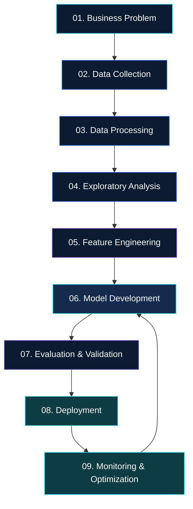

 
<div align="center">


<br/>

<a href="https://github.com/masterj23s25j27-sys">

</a>
<a href="https://github.com/masterj23s25j27-sys?tab=repositories">

</a>
<a href="https://masterj23s25j27-sys.github.io/Kakkarot/">

</a>

<br/><br/>

**ENGINEERING INTELLIGENCE. BUILDING INNOVATION. DELIVERING IMPACT.**

</div>

---

<div align="center">

# `01` — WHO AM I?

### 👨‍💻 JAYESH SHARMILA JAYANAND KURUNGODAN

**AI ENGINEER | AI CONSULTANT | MACHINE LEARNING | GENERATIVE AI**

</div>

I am passionate about Artificial Intelligence, intelligent software engineering, data science and developing technology-driven solutions for real-world challenges.

My interests span the complete AI development lifecycle — from understanding business problems and processing data to engineering machine learning models, developing generative AI applications and deploying intelligent systems.

I focus on connecting **AI engineering, analytical thinking and business requirements** to create solutions that deliver practical value.

```python
class AIEngineer:

    def __init__(self):
        self.name = "Jayesh Sharmila Jayanand Kurungodan"
        self.role = ["AI Engineer", "AI Consultant"]
        self.domains = [
            "Artificial Intelligence",
            "Machine Learning",
            "Deep Learning",
            "Generative AI",
            "Data Science",
            "AI Automation"
        ]
        self.mission = "Build intelligent solutions for real-world problems"

    def build(self):
        return "Ideas → Intelligence → Innovation → Impact"


me = AIEngineer()
print(me.build())
```

### 🎯 Areas of Focus

- 🤖 Artificial Intelligence Engineering
- 🧠 Machine Learning & Deep Learning
- 💬 Generative AI & Large Language Models
- 🔍 Retrieval-Augmented Generation (RAG)
- 🕸️ Agentic AI & Intelligent Agents
- 📊 Data Science & Advanced Analytics
- ⚙️ AI Automation & Intelligent Workflows
- ☁️ AI Deployment & MLOps
- 💡 AI Consulting & Technology Strategy

---

<div align="center">

# `02` — TECHNOLOGY ECOSYSTEM

*Technologies, frameworks and engineering domains I work with and explore.*

</div>

### 💻 Programming Languages

<p align="center">

</p>

### 📊 Data Science & Analytics

<p align="center">

</p>

### 🧠 Machine Learning & Deep Learning

<p align="center">

</p>

<p align="center">


</p>

### 💬 Generative AI & LLM Engineering

<p align="center">


</p>

<p align="center">


</p>

### 🌐 Web Development & API Engineering

<p align="center">

</p>

### ☁️ Cloud, DevOps & Deployment

<p align="center">

</p>

### 🗄️ Database & Data Engineering

<p align="center">

</p>

### 🔬 Research & Development Environment

<p align="center">

</p>

---

<div align="center">

# `03` — AI ENGINEERING DOMAINS

</div>

<table>
<tr>
<td width="50%" valign="top">

### 🤖 ARTIFICIAL INTELLIGENCE

- Intelligent applications
- Predictive systems
- AI-powered automation
- Decision-support systems
- Intelligent workflows

</td>
<td width="50%" valign="top">

### 🧠 MACHINE LEARNING

- Supervised learning
- Unsupervised learning
- Ensemble learning
- Feature engineering
- Hyperparameter optimization

</td>
</tr>
<tr>
<td width="50%" valign="top">

### 🔬 DEEP LEARNING

- Artificial Neural Networks
- Convolutional Neural Networks
- Recurrent Neural Networks
- Transformers
- Computer Vision

</td>
<td width="50%" valign="top">

### 💬 GENERATIVE AI

- Large Language Models
- Retrieval-Augmented Generation
- AI chatbots and assistants
- Prompt engineering
- AI agents

</td>
</tr>
<tr>
<td width="50%" valign="top">

### 📊 DATA SCIENCE

- Data preprocessing
- Exploratory Data Analysis
- Statistical analysis
- Data visualization
- Explainable AI

</td>
<td width="50%" valign="top">

### ⚙️ AI ENGINEERING

- Model evaluation
- API development
- Model deployment
- Automation pipelines
- MLOps and monitoring

</td>
</tr>
</table>

---

<div align="center">

# `04` — HOW I ENGINEER AI SOLUTIONS

*From problem discovery to intelligent deployment.*

</div>



---

<div align="center">

# `05` — PROJECT PORTFOLIO

*Exploring engineering across different domains of technology.*

</div>

| Repository Domain | Engineering Focus |
|:---|:---|
| 🤖 AI Engineering | Intelligent applications and AI solutions |
| 🧠 Machine Learning | Predictive modelling and model optimization |
| 🔬 Deep Learning | Neural networks and advanced architectures |
| 💬 Generative AI | LLMs, RAG and AI assistants |
| 📊 Data Science | Analytics, statistics and visualization |
| 🐍 Python Development | Software development and automation |
| 🌐 Full-Stack Development | Frontend, backend and APIs |
| 🔍 AI Research | Experimental methods and model evaluation |

<div align="center">

<a href="https://github.com/masterj23s25j27-sys?tab=repositories">

</a>

</div>

---

<div align="center">

# `06` — GITHUB ANALYTICS

*Live statistics from my GitHub activity.*

<br/>


<br/><br/>


</div>

---

<div align="center">

# `07` — CONTRIBUTION ACTIVITY


</div>

---

<div align="center">

# `08` — CURRENT LEARNING & EXPLORATION

</div>

| Research Area | Technical Direction |
|:---|:---|
| Agentic AI | Autonomous agents and multi-agent systems |
| Generative AI | Advanced LLM architectures |
| RAG | Context retrieval and knowledge systems |
| Explainable AI | SHAP, LIME and model interpretation |
| Model Engineering | Optimization and validation |
| MLOps | Production AI pipelines |
| AI Automation | Intelligent workflow orchestration |
| Responsible AI | Reliability, transparency and evaluation |

---

<div align="center">

# `09` — AI CONSULTING & COLLABORATION

### Turning Business Challenges Into Intelligent Solutions

</div>

I am interested in applying AI engineering to practical business and technology challenges.

**Areas of collaboration:**

- AI strategy and implementation
- Business process automation
- Predictive analytics
- Intelligent information systems
- Generative AI integration
- Machine learning development
- Data-driven decision support
- AI research and experimentation

My approach is to understand the problem first, evaluate the available technology, build a reliable solution and measure its practical impact.

---

<div align="center">

# `10` — CONNECT WITH ME

### Let's Build Something Intelligent.

<a href="https://github.com/masterj23s25j27-sys">

</a>

<a href="https://www.linkedin.com/">

</a>

<a href="mailto:YOUR_EMAIL">

</a>

<a href="https://masterj23s25j27-sys.github.io/Kakkarot/">

</a>

<br/><br/>

**JAYESH SHARMILA JAYANAND KURUNGODAN**

AI ENGINEER | AI CONSULTANT | MACHINE LEARNING | GENERATIVE AI

<br/>

*Engineering Intelligence. Building Innovation. Delivering Impact.*


</div>
