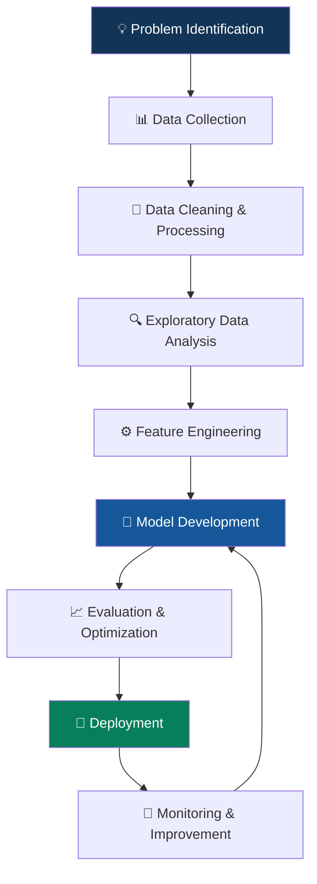

 
<!-- ====================================================== -->
<!-- JAYESH SHARMILA JAYANAND KURUNGODAN - GITHUB PROFILE -->
<!-- ====================================================== -->

 

  

**Engineering Intelligence. Building Innovation. Delivering Impact.**

---

## 👨‍💻 ABOUT ME

Hello! I'm **Jayesh Sharmila Jayanand Kurungodan**, an AI Engineer and AI Consultant passionate about designing, developing and deploying intelligent systems that solve real-world problems.

I work across the AI development lifecycle, from data preparation and exploratory analysis to machine learning, deep learning, generative AI, intelligent automation and deployment.

My focus is on combining technical engineering, analytical thinking and business understanding to transform complex challenges into practical AI-driven solutions.

- 🤖 AI Engineering & Intelligent Systems
- 🧠 Machine Learning & Deep Learning
- 💬 Generative AI, LLMs & RAG Architectures
- 📊 Data Science & Advanced Analytics
- ⚙️ AI Automation & Intelligent Agents
- ☁️ AI Model Deployment & MLOps
- 💡 AI Consulting & Technology Strategy
- 🚀 Research, Experimentation & Innovation

**My Philosophy:** AI should not simply process information; it should create meaningful solutions.

---

## 🧭 EXPLORE MY TECHNOLOGY ECOSYSTEM

| Domain | Focus Areas |
|:---|:---|
| 🤖 Artificial Intelligence | Intelligent Systems, AI Applications |
| 🧠 Machine Learning | Supervised, Unsupervised, Ensemble Learning |
| 🔬 Deep Learning | CNN, RNN, Transformers, Neural Networks |
| 💬 Generative AI | LLMs, Prompt Engineering, RAG |
| 🕸️ AI Agents | Agentic AI, Tool Calling, Workflow Automation |
| 📊 Data Science | EDA, Statistics, Feature Engineering |
| ⚙️ MLOps | Model Evaluation, Deployment, Monitoring |
| 💼 AI Consulting | AI Strategy, Business Automation, Solutions |

---

## 🛠️ TECHNICAL SKILLS & TECHNOLOGY STACK

### 💻 Programming Languages

### 📊 Data Science & Analytics

### 🧠 Artificial Intelligence & Machine Learning

### 🧬 Machine Learning Frameworks

### 💬 Generative AI & LLM Ecosystem

### 🌐 Web Development & API Engineering

### ☁️ Cloud, DevOps & Deployment

### 🗄️ Databases & Data Engineering

### 🔬 Development & Research Tools

---

## 🚀 WHAT I BUILD

<table>
<tr>
<td width="50%">

### 🤖 AI-Powered Applications

- Intelligent AI applications
- Predictive analytics systems
- AI-powered recommendation engines
- Automated decision-support systems

</td>
<td width="50%">

### 🧠 Machine Learning Systems

- Classification and regression
- Clustering and dimensionality reduction
- Ensemble learning architectures
- Model optimization and evaluation

</td>
</tr>
<tr>
<td width="50%">

### 💬 Generative AI Solutions

- AI chatbots and assistants
- Retrieval-Augmented Generation
- LLM-powered applications
- AI agents and tool integration

</td>
<td width="50%">

### 📊 Data Intelligence

- Data analytics pipelines
- Statistical analysis
- Interactive dashboards
- Business intelligence solutions

</td>
</tr>
</table>

---

## 🏗️ MY DEVELOPMENT WORKFLOW

---

## 📂 PROJECT PORTFOLIO

Explore my repositories across different technical domains.

| Project Category | Description |
|:---|:---|
| 🤖 AI Engineering | Intelligent application development |
| 🧠 Machine Learning | Predictive modelling and classification |
| 🔬 Deep Learning | Neural networks and advanced architectures |
| 💬 Generative AI | LLM applications, RAG and AI assistants |
| 📊 Data Science | Statistical analysis and visualization |
| 🌐 Python Development | APIs, automation and backend systems |
| ⚙️ AI Automation | Intelligent workflows and agents |
| 🔍 Research Projects | Experimental AI and ML implementations |

**Explore all projects:** [GitHub Repositories](https://github.com/YOUR_USERNAME?tab=repositories)

---

## 📈 GITHUB ANALYTICS

 

---

## 📊 CONTRIBUTION ACTIVITY

---

## 🐍 CONTRIBUTION SNAKE

---

## 🧩 CURRENT INTERESTS & LEARNING

- Advanced Generative AI architectures
- Agentic AI and multi-agent systems
- Large Language Model optimization
- Retrieval-Augmented Generation
- AI model evaluation and explainability
- Production-grade machine learning
- Intelligent business automation
- Responsible and explainable AI

---

## 🤝 AI CONSULTING & COLLABORATION

Interested in collaborating on projects involving:

- AI-powered business transformation
- Machine learning implementation
- Generative AI integration
- Intelligent automation
- Data-driven decision systems
- AI research and development

I believe successful AI engineering requires more than building models. It requires understanding the problem, selecting the right technology, validating the solution and delivering measurable value.

---

## 🌐 CONNECT WITH ME

---

**Jayesh Sharmila Jayanand Kurungodan**

*AI Engineer | AI Consultant | Machine Learning | Generative AI*

